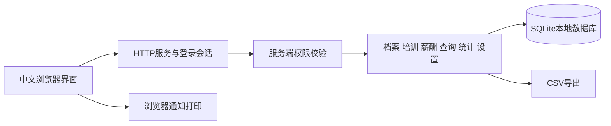

# 人力资源管理系统需求设计与测试

## 范围

本程序实现用户文档中的人力资源管理系统。文档未指定开发语言、框架或数据库，因此采用 Python 标准库与 SQLite，降低 Windows 课程验收的安装成本。学校实践评分和材料上传要求不作为软件接口或业务。

## 架构



界面以资源元数据生成表格和表单，生日、工资、报表采用专门页面。业务层统一验证日期、金额、枚举及关联对象，并通过事务保存依赖操作。HTTP 层不直接拼接 SQL；静态文件只从 static 目录读取。

## 主要数据关系

- 部门关联职工，职工关联社保、奖罚、调动、证书、请假和工资登记。
- 课程关联内部和一线工培训，培训关联参加员工。
- 加班登记关联员工和加班标准，计件/计时登记关联员工与月份。
- 工资档案关联员工与月份，保存收入、扣款、应发、实发与发放状态快照。
- 用户关联角色，角色包含模块权限；每次请求读取当前用户权限。

职工调动保存业务记录时同步更新职工档案。被引用记录的删除会受到约束，避免生成无归属数据。已发放工资保存计算快照，后续比例或工资改变不回写历史。

## 安全与输入

密码使用随机盐的密码派生散列保存。登录会话使用随机令牌和 HttpOnly、SameSite cookie，修改请求校验 CSRF 令牌及来源。未登录和无权限请求分别返回 401 和 403；输入错误返回具体中文提示。请求体限制为 1 MiB。静态路径限制阻止数据库和服务源文件从网页下载。CSV 提供 UTF-8 BOM，用户文本以安全方式导出。

默认仅开放本机地址。这里的账户和权限机制用于课程演示，不构成公网生产部署方案。

## 核心算法

工资按员工和月份汇总原始记录。金额使用 Decimal，逐项计算后保留两位小数。已批准无薪假按当月覆盖的请假记录计算，待审批记录不扣薪。发放在事务中检查工资状态，更新后防止重复操作；已发放记录不能由生成操作覆盖。

生日按下一次有效生日计算，跨年度生日仍可提醒；2月29日生日在非闰年按2月28日提醒。年龄和工龄按当前日期计算，人员结构统计当前未离职员工，月度入职/离职按选择年度的档案日期归集。年度离职率 = 当年离职人数 / ((年初人数 + 年末人数) / 2) × 100%；平均人数为零时显示0%。课程示例未使用劳动政策折算，此口径可能出现超过100%的离职率。

## 验证方法

运行：

```text
python -m unittest discover -s tests -v
```

自动测试使用临时数据库。覆盖业务 CRUD、权限、日期/枚举/金额/关系验证、调动同步、请假审批、工资汇总、发放后锁定、生日、统计和导出；HTTP 测试覆盖登录/注销、会话、CSRF、来源校验、错误 JSON、持久化操作及静态文件隔离。

人工浏览器验收覆盖登录、各模块导航、员工创建与编辑、搜索、工资生成与发放、通知打印、报表、窄屏布局，以及实际控制台错误。最终测试结果写入独立验收记录，未验证的行为不写为通过。

## 交付与边界

交付完整源代码、Windows 启动脚本、操作说明、设计与测试材料。未自动生成个人实践经历、考勤、周志或评分，没有代替用户提交学校材料。

运行数据保存在本地文件；目前不提供外部银行、企业社保接口或课程平台集成。工资税费和地区政策可在后续扩展时单独配置。
